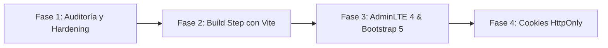

# Informe de Deuda Técnica y Plan de Modernización — Frontend ERP SaaS P.M.E.

## 1. Clasificación General de la Deuda Técnica

La deuda técnica del frontend de **Inventario P.M.E.** ha sido identificada y clasificada según su urgencia, complejidad de resolución e impacto en la escalabilidad como producto SaaS:

```
[ Deuda Crítica / Seguridad ] ──> RESUELTA EN AUDITORÍA (CWE-209, XSS, Impersonación, Fail-Closed)
[ Deuda Media / Rendimiento ]  ──> MITIGADA (Cache-Busting, Chart.js Leaks, Throttling)
[ Deuda Arquitectónica / Futuro ] ──> HOJA DE RUTA DE MODERNIZACIÓN (Bootstrap 5, Bundler, TypeScript)
```

---

## 2. Matriz de Deuda Técnica Identificada

| Ítem | Categoría | Severidad / Prioridad | Estado Actual | Mitigación Aplicada / Propuesta de Modernización |
| :--- | :--- | :--- | :--- | :--- |
| **Arquitectura Híbrida MPA/SPA** | Arquitectura | **Media** | Vistas PHP independientes con enrutamiento de cliente en `App.js`. | **Mitigado:** Se eliminó la doble invocación de `App.bootstrap()` y se centralizó el control en `AuthGuard`. A futuro, evaluar migración a SPA moderna (Vue 3 / React) o Inertia.js. |
| **Ausencia de Bundler / Build Step** | Herramientas / Build | **Baja** | Módulos ES6+ nativos servidos sin empaquetar ni minificar. | Los navegadores modernos con HTTP/2 gestionan bien la carga modular. A futuro, integrar **Vite** para minificación, tree-shaking y compresión Gzip/Brotli. |
| **Dependencia de jQuery y Bootstrap 4** | Librerías / Stack | **Media** | AdminLTE 3.2.0 está anclado a Bootstrap 4.6 y jQuery 3.6. | **Mitigado:** Todo el código nuevo/revisado utiliza Vanilla JS ES6+. A futuro, migrar a **AdminLTE 4** (basado en Bootstrap 5 sin dependencia obligatoria de jQuery). |
| **Versión de Chart.js (v2.9.4)** | Librerías | **Baja** | Se utiliza Chart.js 2.9.4. | **Mitigado:** Se eliminaron todas las fugas de memoria y se adaptó la sintaxis a v2. Funciona con alta estabilidad. Modernizar a v4 únicamente en un rediseño de reportes. |
| **Almacenamiento de JWT en localStorage** | Seguridad / Sesión | **Media** | Tokens de acceso y refresco persisten en `localStorage`. | **Mitigado:** `Storage.js` y `ApiClient.js` aíslan el token y limpian ante logout/401. Para máxima protección OWASP, coordinar con Backend la adopción de cookies `HttpOnly; SameSite=Lax; Secure`. |
| **DataTables con jQuery** | Componentes | **Baja** | DataTables 1.10 acoplado a selectores jQuery. | **Mitigado:** Estandarizado al 100% mediante `DataTableHelper.js` con diccionario offline y protección RBAC en botones de exportación. |
| **Código Huérfano en Raíz (`routes/web.php`, `auth.php`)** | Mantenibilidad | **Baja** | Archivos sin uso en tiempo de ejecución. | Documentados en `DEAD_CODE_REPORT.md` con instrucciones precisas para su retiro manual. |

---

## 3. Análisis Detallado de Áreas Clave

### 3.1 Stack Visual: AdminLTE 3 / Bootstrap 4 vs AdminLTE 4 / Bootstrap 5
- **Situación:** AdminLTE 3.2.0 ha demostrado ser sumamente robusto para ERPs tradicionales, pero introduce una huella en memoria debido a jQuery y los plugins de Bootstrap 4.
- **Riesgo:** Bootstrap 4 se encuentra en modo mantenimiento por la comunidad.
- **Recomendación:** No reescribir inmediatamente la interfaz; la actual funciona con excelente rendimiento tras el saneamiento. Planificar la migración a AdminLTE 4 en el siguiente hito mayor (v2.0).

### 3.2 Estrategia de Empaquetado (Bundling con Vite)
- **Situación:** Actualmente el proyecto carga ~10-15 módulos JS por vista mediante `<script type="module">`.
- **Beneficio actual:** Cero dependencias de `npm install` para correr el proyecto en entornos PHP/XAMPP locales; cambios en caliente inmediatos sin esperar compilación.
- **Plan de Modernización:**
  - Mantener desarrollo sin build tool para máxima agilidad en XAMPP.
  - Para producción, introducir una configuración ligera de `vite build` que genere un bundle minificado con hashes en filenames.

---

## 4. Hoja de Ruta Progresiva de Modernización



1. **Fase 1 (Completada):** Hardening de seguridad OWASP, resolución del bug de impersonación, cliente API unificado, normalización de errores DRF, cache-busting determinista y eliminación de fugas de memoria.
2. **Fase 2 (Próximo Sprint):** Retiro de archivos de código muerto documentados y configuración opcional de Vite para producción.
3. **Fase 3 (Siguiente Versión Mayor):** Actualización a AdminLTE 4 / Bootstrap 5 eliminando jQuery de la capa de vistas.
4. **Fase 4 (Coordinación Backend):** Migración a cookies seguras HttpOnly para tokens JWT.
